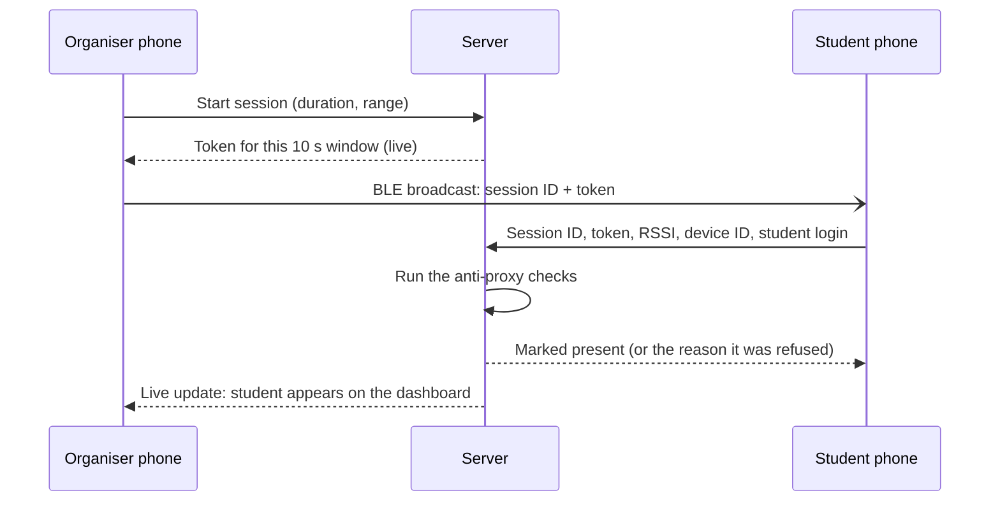

<div align="center">

# ProxyProof

**Bluetooth attendance that marks students present automatically, and makes proxy attendance very hard.**


</div>

An organiser starts a session and their phone broadcasts a Bluetooth signal that carries a **code which changes every 10 seconds**. Students' phones pick it up and report to the server, which marks attendance only if every anti-proxy check passes. No taps, no QR codes, no shared passwords.

---

## Contents

- [Features](#features)
- [How it works](#how-it-works)
- [Quick start](#quick-start)
- [Testing needs two devices](#testing-needs-two-devices)
- [Demo accounts](#demo-accounts)
- [Real Bluetooth on physical phones](#real-bluetooth-on-physical-phones)
- [Project structure](#project-structure)
- [Troubleshooting](#troubleshooting)
- [Known limitations](#known-limitations)

---

## Features

| For | What you get |
|---|---|
| **Students** | Open the app near the organiser and you are marked automatically. A history screen shows the attendance percentage for each class and warns below 75%. |
| **Organisers** | Start a timed session, watch students appear live, add or remove marks by hand, see blocked proxy attempts, close the session, and export a CSV for one session or the whole class. |
| **Admins** | Approve or decline requests to switch a student's phone. |

## How it works



### The anti-proxy checks

All of them live in one function, `verifyMark` in [`server/src/attendance.js`](server/src/attendance.js).

| # | Check | Refusal code |
|---|---|---|
| 1 | The session is open and not past its end time | `session_closed` |
| 2 | The student is enrolled in the class | `not_registered` |
| 3 | The request comes from the phone bound to that student | `wrong_device` |
| 4 | The token is from the current or previous 10 second window | `stale_token` |
| 5 | Signal strength (RSSI) is at or above the session threshold, default -80 dBm | `too_far` |
| 6 | That phone has not already marked a different student | `device_already_used` |

Every refusal is stored and shown to the organiser as a **blocked attempt**.

**Rotating tokens.** The token is an HMAC of a per-session secret and the current 10 second window, so a screenshot or a forwarded code stops working almost immediately.

**One phone per student.** A student's first login binds their account to that phone. Signing in on a different phone creates a request that an admin must approve. A phone can belong to only one student.

---

## Quick start

You need **Node 22 or newer** (the server uses the built-in `node:sqlite`) and **npm**. About five minutes.

### 1. Start the server

```bash
cd server
npm install
npm run seed     # creates demo users, classes and attendance history
npm start        # http://localhost:4000
```

The server prints your computer's Wi-Fi address on start, for example `http://192.168.1.20:4000`. You will need it for physical phones.

### 2. Start the app

In a second terminal:

```bash
cd app
npm install
npx expo start
```

### 3. Open it on a device

| Where | How |
|---|---|
| **Browser** (quickest) | Press `w` in the Expo terminal, or open http://localhost:8081 |
| **Android emulator** | `npx expo run:android` (first build takes several minutes) |
| **Physical phone** | `npx expo run:android --device` or `npx expo run:ios --device` |

If the app can't reach the server from a physical phone, open **Server settings** on the login screen and enter the address the server printed. Or set `EXPO_PUBLIC_API_URL` before starting Expo.

> **Android builds:** you need Android Studio and a **JDK 17**. A patch for `react-native-ble-advertiser` is applied automatically on `npm install`.

---

## Testing needs two devices

> **ProxyProof only works with two devices running at the same time.**
> One plays the **organiser** and broadcasts. The other plays the **student** and listens. A single device can hold only one login, so it cannot do both jobs.

Keep both running while you test, and make sure the server is up.

| Option | Device A (organiser) | Device B (student) | Bluetooth |
|---|---|---|---|
| **Easiest** | Browser tab at `localhost:8081` | A second browser tab, or an incognito window | Simulated |
| **Mixed** | Android emulator | Browser tab at `localhost:8081` | Simulated |
| **The real thing** | Physical phone | Another physical phone | Real |

Each browser tab acts as its own phone, with its own device ID.

### Step by step

1. **Device A.** Sign in as **Organiser** (`FAC01`). On Classes, tap **Start session** on *Computer Networks*, then **Start session** again. The Live tab shows the pulse ring and the changing code.
2. **Device B.** Sign in as a **student** (`23CS002`). Stay on the **Today** tab; the app only listens while that screen is open.
3. **Both devices.** Open **Profile** and check Signal source. Use **Simulated** unless you are testing real Bluetooth on two physical phones.
4. **Watch.** On Device B the ring tightens (*Found CS3401*) and turns green (*You're marked present*). On Device A the student appears in the Marked list and the counter goes up.
5. **Try to cheat.** Drag the simulated distance slider on Device B to the far end: the student is told to move closer. Wait for a code to expire, or sign in as the same student on a third device: the server refuses and the attempt shows up as **blocked** on Device A.

### Mistakes that look like bugs

- **Both roles on one device.** Nothing will ever be marked.
- **A student who isn't enrolled in the broadcast class.** The Live tab broadcasts one session; only students enrolled in that class can hear it. `23CS001` to `23CS012` are in *Computer Networks* and *Operating Systems*.
- **A student bound to another phone.** `23CS001` may already be linked to a different device. Use another student, or approve the change as `ADMIN`.
- **One device on Bluetooth, the other on Simulated.** They will never hear each other. Set both devices to the same mode in Profile.
- **Student not on the Today tab.** It is not listening.

---

## Demo accounts

Every account uses the password `proxyproof`.

| Role | Roll number | Notes |
|---|---|---|
| Admin | `ADMIN` | Approves phone changes |
| Organiser | `FAC01` | Computer Networks, Operating Systems |
| Organiser | `FAC02` | Machine Learning |
| Students | `23CS001` to `23CS012` | `23CS001` to `23CS008` are also in Machine Learning |

Reset to a clean demo any time: stop the server, then run `npm run seed` in `server/`.

---

## Real Bluetooth on physical phones

Bluetooth advertising and scanning need native code, so this needs a **development build**, not Expo Go, and it will not work in the simulator, the emulator or the browser.

```bash
cd app
npx expo run:android --device     # or: npx expo run:ios --device
```

Install on **two phones**, both on the same Wi-Fi as the server, then:

1. Phone A signs in as an organiser and phone B as a student.
2. On both, open **Profile** and set Signal source to **Bluetooth**. Allow the Bluetooth permissions.
3. Phone A starts a session. The ring shows a code that changes every 10 seconds.
4. Phone B, on **Today**, should switch to *Found CS3401* and then *You're marked present* within a few seconds.
5. Walk away until the signal drops below the threshold. Phone B should say to move closer.

The beacon packs `PROX | sessionId | token | check` into one 128-bit service UUID ([`app/src/ble/payload.ts`](app/src/ble/payload.ts)), because iOS cannot advertise manufacturer data. Advertising uses `react-native-ble-advertiser` and scanning uses `react-native-ble-plx`.

---

## Project structure

```
server/                Node API and live socket
  src/attendance.js    the anti-proxy checks, history, CSV export
  src/tokens.js        rotating HMAC tokens
  src/app.js           REST routes and device binding
  src/live.js          WebSocket: token rotation and live marks
  src/seed.js          demo data
app/                   Expo (React Native) app
  src/app/             screens: login, student, organiser, admin
  src/components/      pulse ring, cards, buttons, session view
  src/ble/             native and simulated Bluetooth
  src/api/             API client and live socket
  patches/             fix for react-native-ble-advertiser on modern Android
```

---

## Troubleshooting

| Problem | Fix |
|---|---|
| App says it can't reach the server | Check the server is running. On a phone, set the server address under **Server settings** on the login screen. For the Android emulator run `adb reverse tcp:4000 tcp:4000` and `adb reverse tcp:8081 tcp:8081`. |
| Android build fails on the Java toolchain | Use a JDK 17 as `JAVA_HOME`. |
| Student sees "Waiting for admin approval" | The account is bound to another phone. Sign in as `ADMIN` and approve the request, or use a different student. |
| Student never turns green | Check both devices use the same signal mode, the student is on **Today**, and the student is enrolled in the class being broadcast. |
| `port 4000 already in use` | Another server is on that port. Stop it or run with `PORT=4001 npm start` and point the app to it. |
| Want a clean slate | Stop the server, run `npm run seed` in `server/`. |

## Known limitations

- **Native Bluetooth has not been tested on physical hardware.** The advertise and scan path is written against the libraries' documented APIs but has only been verified in simulated mode.
- **RSSI is reported by the student's phone.** A modified client could fake it. The rotating token, device binding and one-phone-per-student rules limit what that buys, but this is not tamper-proof.
- **Relay attacks.** Someone who rebroadcasts the signal to a remote friend inside the 10 second window could still get through. A shorter rotation narrows the window.
- **The student app must stay open.** iOS does not allow unfiltered Bluetooth scanning in the background.
- **Demo scope.** Seeded accounts with a shared password, a local SQLite file, no email flows and no production hosting.
